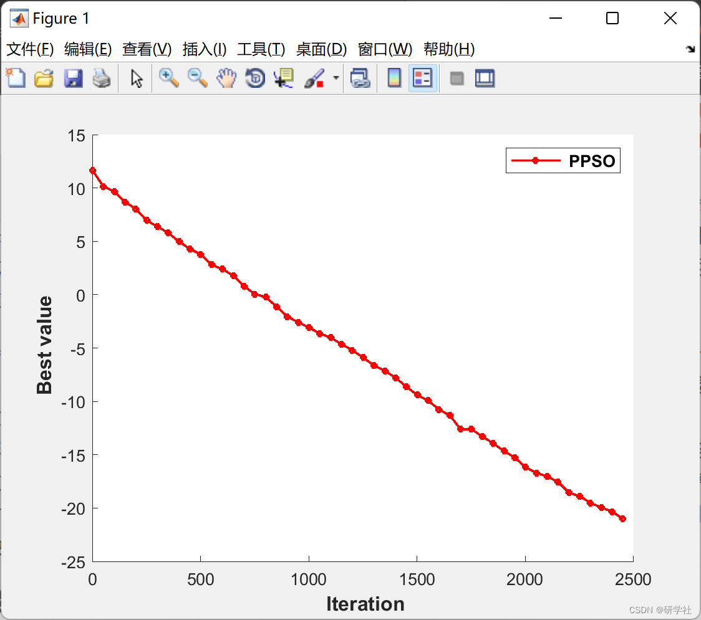
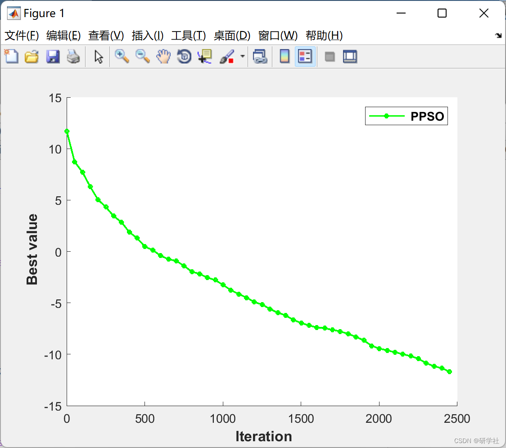
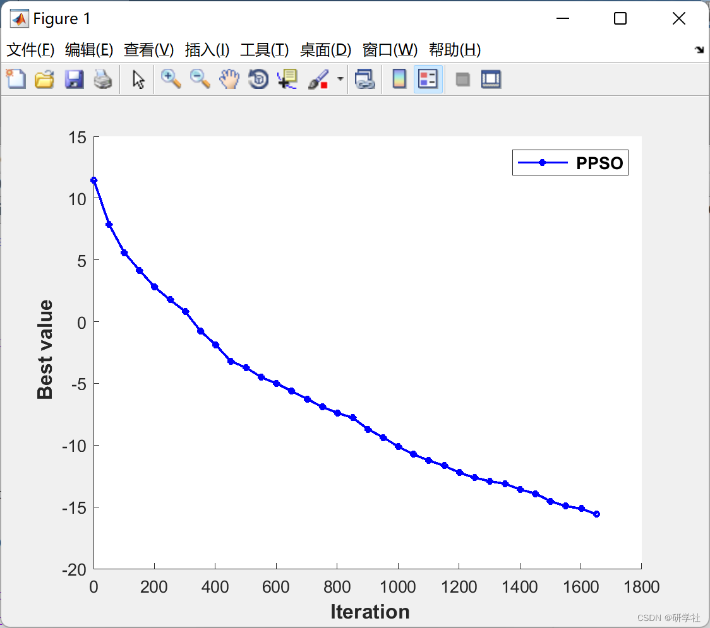

# [Improving Particle Swarm Optimization Algorithm] Vectorial Percussion Particle Swarm Optimization (PPSO) Algorithm (implemented in MATLAB)

💥💥💞💞 Welcome to this blog❤️❤️💥💥
🏆 Bloggers' Advantage: 🌞🌞🌞 The content of the blog strives to be rigorous in thought and clear in logic, for the convenience of readers.
⛳️ Mantra: "Those who travel a hundred miles may arrive at the ninety-ninth mile." 📜
💥1 Overview of the Particle Perturbation Stiefel Manifold Optimization (PPSO) is inspired by phase-space theory in mathematics.
Particle Swarm Optimization (PSO) is a new major sample of PSO, based on the modeling of particle control parameters for phase angles (θ), inspired by phase-angle theory in mathematics. This phase angle (θ) transforms the PSO algorithm into an adaptive, triangular, balanced, and non-parametric heuristic algorithm. The performance of PPSO has been tested on real parameter optimization problems, including unimodal and multimodal standard test functions as well as traditional benchmark functions.
Particle Swarm Optimization (PSO) is a well-known algorithm based on efficient global and control parameters, used for global optimization of various problems. This paper focuses on introducing a new PSO variant, named Phase Particle Swarm Optimization (PPSO), which is based on the phase angle (θ) particle control parameter model inspired by mathematical phase theory. The phase angle (θ) converts the PSO algorithm into an adaptive, triangular, balanced, and non-parametric heuristic algorithm. The performance of PPSO has been tested on real parameter optimization problems, including unimodal and multimodal standard test functions as well as traditional benchmark functions. The optimization results show that the PPSO algorithm performs well and efficiently in real parameter global optimization, especially for high-dimensional optimization problems, compared to other improved PSO algorithms in the literature. The phase model can be used to extend different types of PSO and other algorithms.
📚2 Running Results Editing
Editor
Edit the code section:
for it=1:maxit  
if it==1  
gbestcost(1)=inf;  
for i=1:npop  
velocity(i,:)=zeros(1,nvar);  
delta(i)=unifrnd(0,2*pi);  
position(i,:)=xmin+(xmax-xmin)*rand(1,nvar);  
cost(i)=CostFunction(position(i,:));  
pbest(i,:)=position(i,:);  
pbestcost(i)=cost(i);  
if pbestcost(i)<gbestcost(it)  
gbest=pbest(i,1:nvar);  
gbestcost(it)=pbestcost(i);  
end  
end  
else  
gbestcost(it)=gbestcost(it-1);  
for i=1:npop  
aa=2*(sin(delta(i)));  
bb=2*(cos(delta(i)));  
ee=abs(cos(delta(i)))^aa;  
tt=abs(sin(delta(i)))^bb;  
r=2.5*rand*rand;  
velocity(i,:)=(ee)*(pbest(i,:)-position(i,:)) +(tt)*(gbest-position(i,:));  
velocity(i,:)=min(max(velocity(i,:),-vmax),vmax);  
position(i,:)=position(i,:)+velocity(i,:);  
position(i,:)=min(max(position(i,:),xmin),xmax);  
cost(i)=CostFunction(position(i,:));  
delta(i)=delta(i)+(abs(aa+bb)*(2*pi));  
vmax=(abs(cos(delta(i)))^2)*dx;  
if cost(i)<pbestcost(i)  
pbest(i,:)=position(i,:);  
pbestcost(i)=cost(i);  
if pbestcost(i)<gbestcost(it)  
gbest=pbest(i,:);  
gbestcost(it)=pbestcost(i);  
end  
end  
end  
end  
disp(['Iteration ' num2str(it) ': Best Cost = ' num2str(gbestcost(it))]);  
end  
hold on;  
figure(1)  
it=1:50:maxit;  
semilogy((it),(log(gbestcost(it))),'-og','linewidth',1.4,'Markersize',3);  
xlabel('\fontsize{12}\bf Iteration');  
ylabel('\fontsize{12}\bf Best value');  
legend('\fontsize{10}\bf PPSO');  
Cost_Rsult=gbestcost(end)  
🎉4 References
[1] Mojtaba Ghasemi, Ebrahim Akbari, Abolfazl Rahimnejad, Seyed Ehsan Razavi, Sahand Ghavidel, and Li Li. "Phasor particle swarm optimization: a simple and efficient variant of PSO." Soft Computing 23, no. 19 (2019): 9701-9718.  
[2] Ebrahim Akbari (2022). Phasor Prticle Swarm Optimization (PPSO) .  
🌈4 MATLAB Code Implementation

## Images

<!-- PAYMENT_BLOCK -->

## Get this dataset

- Payment link (Stripe): [Buy now](https://buy.stripe.com/3cs8yP7sY87d0vu9AB)
- Payment QR code: 

<!-- /PAYMENT_BLOCK -->
